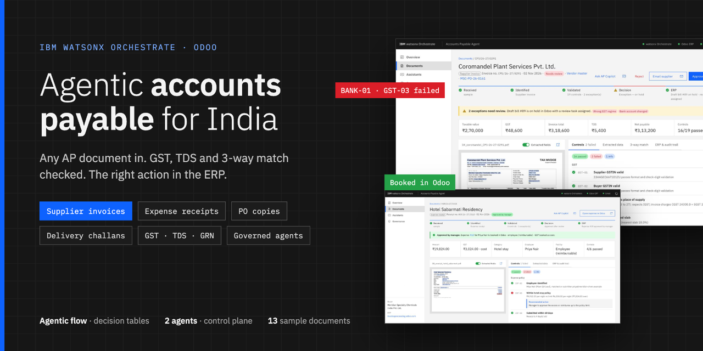
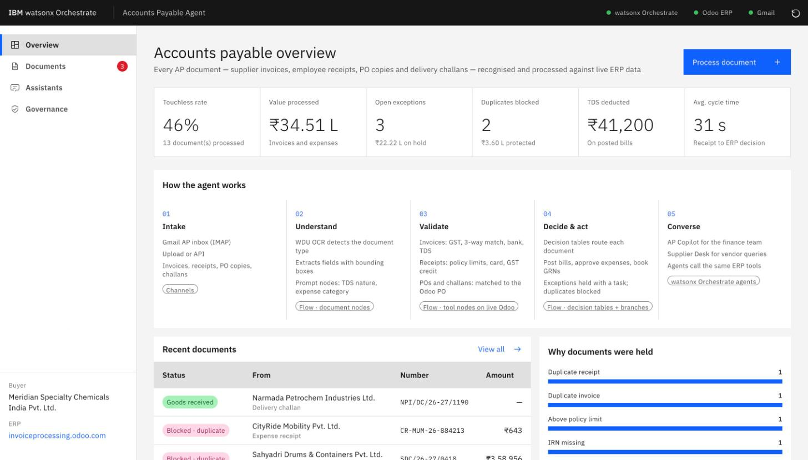
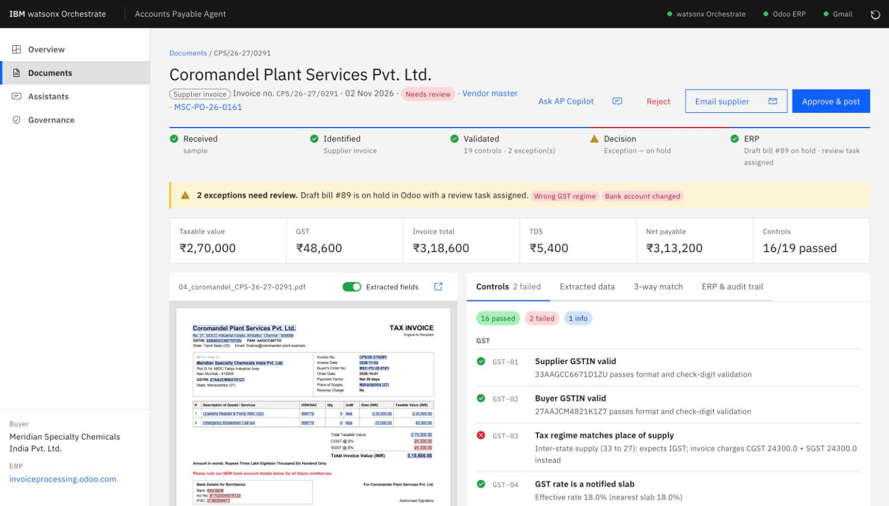
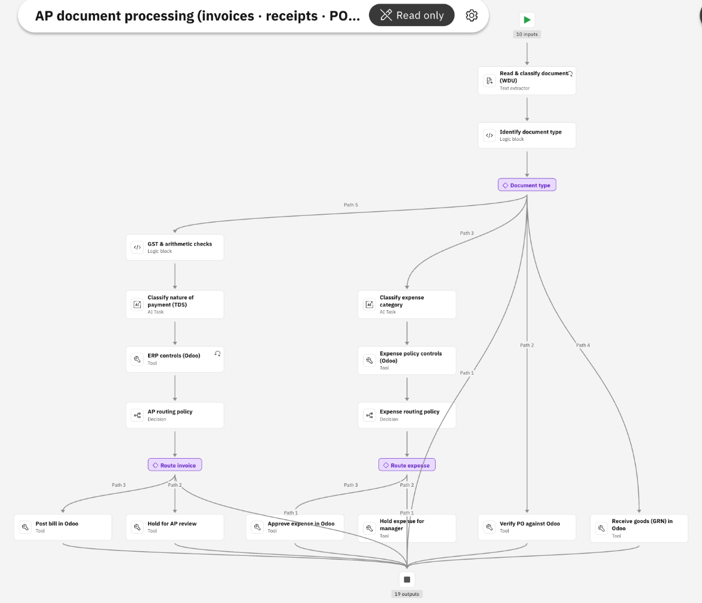
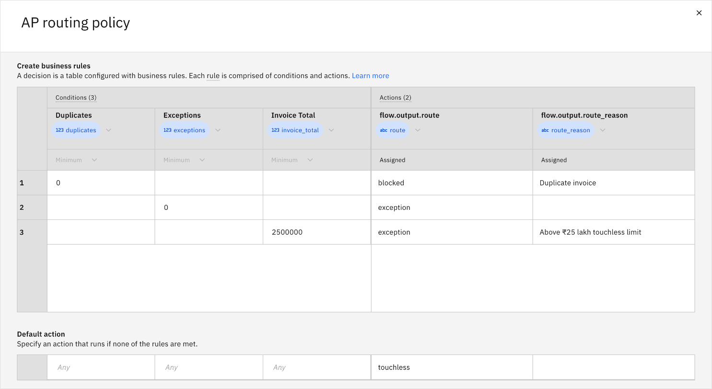
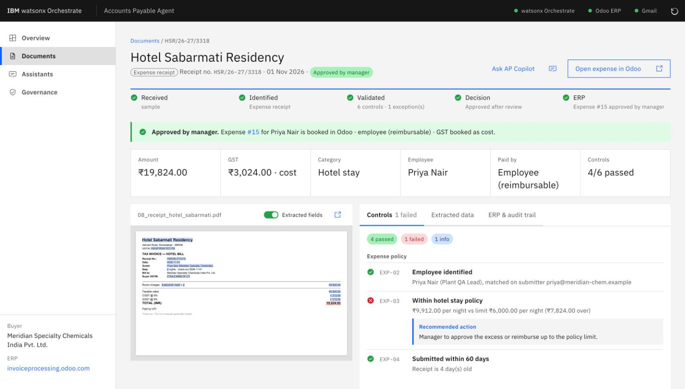
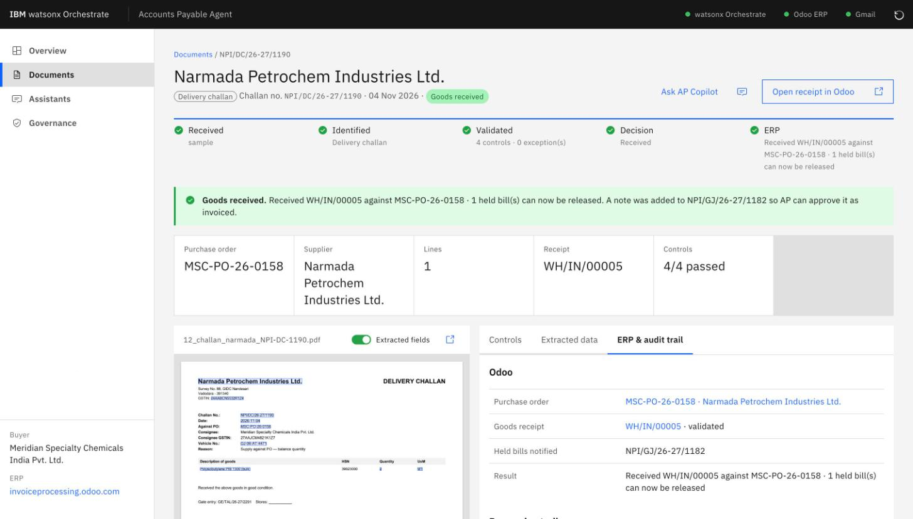
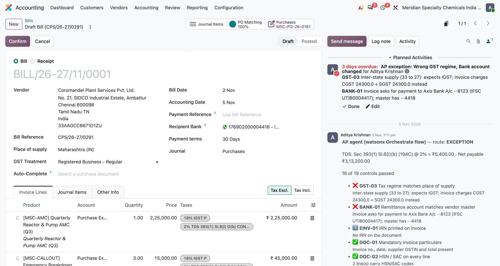
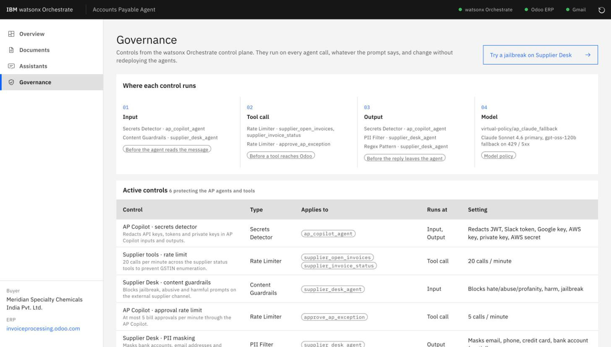
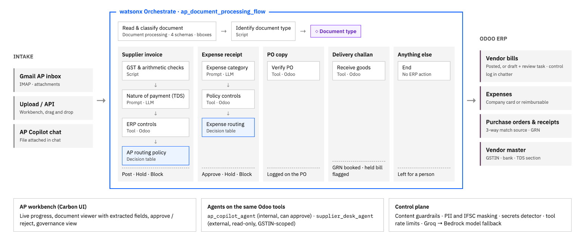

# Agentic Accounts Payable for India — IBM watsonx Orchestrate + ERP



An AI agent that takes any accounts-payable document from receipt to the right action in the ERP. Drop in a
supplier invoice, an employee's taxi or hotel receipt, a PO copy or a delivery challan; watsonx Orchestrate
recognises the type and processes it. For invoices it applies the India-specific controls that generic AP
tools leave to humans: GST regime and GSTIN validation, e-invoice IRN, TDS under the Income-tax Act 2025,
GRN-based 3-way match, duplicate detection and vendor bank-account verification. Clean documents go through
**touchless**. Exceptions are held in the ERP with a task and a recommended action. Two conversational
agents serve the AP team and suppliers from the same live ERP data.

| Document | What the agent does in Odoo |
|---|---|
| Supplier GST invoice | Controls, then posts the bill, holds a draft with a review task, or blocks a duplicate |
| Employee expense receipt (taxi, hotel, meals, card slip) | Policy limits, corporate card, duplicate claims, GST credit eligibility (s.17(5)); approves the expense or holds it for the manager |
| Purchase-order copy | Verifies vendor, lines, quantities and rates against the Odoo PO and logs the result on it |
| Delivery challan / GRN | Books the goods receipt when quantities fit, and flags any bill held for a GRN shortage on that PO |
| Anything else | Marked unsupported and left for a person; nothing changes in the ERP |

**Step-by-step guide:** [Build an agentic accounts-payable system for India with watsonx Orchestrate and Odoo](docs/tutorial/README.md) · [read it as a web page](https://claude.ai/artifact/LeZnzxhrq9psD5PNUU1rLC)

## See it in action

<table>
<tr><td width="50%"><br><sub>AP workbench overview: touchless rate, value on hold, duplicates blocked, TDS</sub></td><td width="50%"><br><sub>Invoice held for review, with the failing fields outlined on the document</sub></td></tr>
<tr><td width="50%"><br><sub>The agentic flow in watsonx Orchestrate: one lane per document type</sub></td><td width="50%"><br><sub>AP routing policy as a decision table the AP team can edit</sub></td></tr>
<tr><td width="50%"><br><sub>Hotel receipt over the ₹6,000/night policy, held for the manager</sub></td><td width="50%"><br><sub>Delivery challan booked as a goods receipt in Odoo</sub></td></tr>
<tr><td width="50%"><br><sub>Draft bill in Odoo with the review task and the agent's control log</sub></td><td width="50%"><br><sub>Control-plane governance: guardrails, PII masking, rate limits, model fallback</sub></td></tr>
</table>

Odoo is the reference ERP (vendor master, POs, goods receipts, vendor bills). The ERP layer is a thin
client (`wxo/tools/apcore/odoo.py`, `wxo/tools/erp.py`), so it can be replaced with SAP S/4HANA OData without touching
the flow or the agents.

## The business problem

A typical Indian manufacturer receives 100–200 supplier invoices a day. Global AP suites handle capture and
PO matching, but these steps usually stay manual:

| Gap | What goes wrong | What the agent does |
|---|---|---|
| **GRN validation** | Invoices are paid for goods not yet received | Billed qty ≤ received − already billed, read live from ERP receipts; proposes "post received qty + request credit note" |
| **TDS** | Wrong section or rate, missed deduction | Nature of payment classified by an LLM, cross-checked against the vendor-master TDS section; rate, thresholds and FY aggregate computed; Odoo withholding tax applied on the bill |
| **GST compliance** | CGST/SGST charged on inter-state supplies, wrong buyer GSTIN, ITC lost | GSTIN check digit, state-code vs place-of-supply regime check, slab check, buyer GSTIN check |
| **E-invoicing** | Invoices without an IRN from mandated suppliers | IRN required when the vendor is tagged *E-invoice applicable* |
| **Payment fraud** | "Please note our new bank details" | Remittance account compared with the verified vendor-master account; exception cannot be approved by the Copilot |
| **Duplicates** | The same invoice re-sent as a scan | Blocked against all non-cancelled ERP bills before any bill is created |
| **Visibility** | Suppliers email AP asking "when will I be paid?" | Supplier Desk agent answers status, TDS withheld and expected payment date, scoped to the caller's GSTIN |

## Architecture



<details><summary>Text version</summary>

```
 Intake            watsonx Orchestrate: ap_document_processing_flow                                    Odoo
 ──────            ────────────────────────────────────────────────                                    ────
 Gmail AP inbox ┐  read_document      docproc · OCR, picks the matching schema = document type, bboxes
 Upload / API ──┼▶ identify_document  script · normalises fields for that type
 AP Copilot ────┘  document type ─┬ supplier invoice → statutory_checks (script) → classify_payment (prompt)
                                  │   → erp_controls (tool) → route_invoice (decision table)
                                  │   → post_bill │ hold_bill │ blocked                              ──▶ bill
                                  ├ expense receipt  → classify_expense (prompt) → expense_controls (tool)
                                  │   → route_expense (decision table) → approve │ hold │ blocked     ──▶ expense
                                  ├ purchase order   → verify_po (tool)                               ──▶ PO note
                                  ├ delivery challan → receive_goods (tool)                           ──▶ GRN
                                  └ other            → end (unsupported, left for a person)

 Workbench (Carbon UI): live progress, document viewer, approve / reject, governance
 Agents: AP Copilot (internal) · Supplier Desk (external), on the same Odoo tools
 Control plane: guardrails, PII and IFSC masking, secrets detection, tool rate limits, model fallback
```

</details>

**Why the work is split this way**

- **The process is a flow, not an agent.** Every document of a given type runs the same steps in the same
  order, so it is a flow with typed nodes. Document processing itself picks the document type from the
  schemas it is given, and a branch sends each type to its own steps. Agents are used only where conversation is the job: the AP team's questions and
  approvals, and supplier status queries.
- **Deterministic where it matters.** Numbers, GSTINs, tax regimes, policy limits and ERP matches are
  checked in code (script and Odoo tool nodes). The LLM classifies only what needs judgement: the nature of
  payment for TDS, and the expense category.
- **Policy is a decision table.** Invoice routing (duplicate → block, any failed control → review, above
  the ₹25 lakh touchless limit → sign-off, otherwise post) and expense routing are decision-table nodes
  that AP can change in the flow editor without code.
- **One engine.** `wxo/tools/apcore` (India rules, Odoo client, controls, booking) is deployed with the
  tools and imported by the workbench for reviewer actions, so the rules never diverge.
- **The ERP is the system of record.** Bills, review tasks (`mail.activity`) and the agent's control log
  (chatter) live in Odoo. Approvals made through the Copilot or directly in Odoo sync back to the workbench.
- **Governed agents.** Least-privilege tools (the Supplier Desk is read-only and GSTIN-scoped), with
  control-plane policies on top that apply whatever the prompt says.

## Governance (watsonx Orchestrate control plane)

Defined in `wxo/controls/*.yaml`, imported by `deploy.sh`, and shown live on the workbench's
**Governance** page.

| Control | Type | Applies to | Runs at | Why |
|---|---|---|---|---|
| Supplier Desk · content guardrails | Content Guardrails | `supplier_desk_agent` | input | External channel: blocks jailbreaks and abuse before the agent sees them |
| Supplier Desk · PII masking | PII Filter | `supplier_desk_agent` | output | Bank accounts, emails and phone numbers never reach a supplier |
| Supplier Desk · IFSC and account redaction | Regex Pattern | `supplier_desk_agent` | output | India identifiers the generic PII filter does not know |
| Supplier tools · rate limit | Rate Limiter | supplier status tools | tool call | 20 calls a minute stops GSTIN or invoice enumeration |
| AP Copilot · approval rate limit | Rate Limiter | `approve_ap_exception` | tool call | Caps the blast radius of the only write tool |
| AP Copilot · secrets detector | Secrets Detector | `ap_copilot_agent` | input + output | Staff paste portal text; credentials are redacted |
| Model policy `ap_gpt_oss_fallback` | Fallback | both agents | model | Groq primary, the same model on Bedrock on 429 / 5xx |

A blocked run returns `USER_CONFIGURED_CONTROL_BLOCKED`, which the chat shows as **Blocked by control**.
Model-level controls on the tenant bind to custom (virtual) models, so the fallback is a model policy.

## Repository

| Path | Purpose |
|---|---|
| `wxo/flows/ap_document_processing_flow.py` | The process: read and classify → branch per document type → controls → decision tables → Odoo |
| `wxo/tools/apcore/` | Shared engine: India rules, Odoo client, invoice controls and booking, expense policy, PO / GRN handling |
| `wxo/tools/` | Flow process tools and agent tools; Odoo credentials come from the `odoo_erp` key-value connection |
| `wxo/controls/` | Control-plane policies (guardrails, PII, regex, rate limits, secrets) |
| `wxo/agents/` | `ap_copilot_agent` (internal) and `supplier_desk_agent` (external) |
| `wxo/deploy.sh` | Creates the connection and imports tools, flow, model policy, agents and controls |
| `app/` | FastAPI workbench (`pipeline.py`, `wxo.py`, `mail.py`, `store.py`) and the Carbon UI in `static/` |
| `scripts/setup_odoo.py` | Idempotent ERP provisioning: apps, GST/TDS taxes, buyer, vendors, products, POs, GRNs, employees, expense categories |
| `scripts/demo_data.py` | One spec for the demo world, shared by the ERP seed and the invoice generator |
| `scripts/generate_samples.py` | Renders the 13 sample documents in `samples/` |

## Setup

```bash
uv venv -p 3.12 .venv && uv pip install -p .venv -r requirements.txt
cp .env.example .env            # fill in wxO, Odoo and (optionally) Gmail

# 1. ERP: works on any Odoo 18+ database with Indian localisation (a free trial is fine)
.venv/bin/python scripts/setup_odoo.py

# 2. watsonx Orchestrate
.venv/bin/orchestrate env add -n ap-demo -u "$WXO_INSTANCE_URL" --type ibm_iam
.venv/bin/orchestrate env activate ap-demo --api-key "$WXO_API_KEY"
ORCH=.venv/bin/orchestrate ./wxo/deploy.sh

# 3. Run
.venv/bin/uvicorn app.main:app --port 8090      # http://localhost:8090
```

**Gmail (optional):** create the AP mailbox, enable 2-Step Verification, create an app password, and set
`GMAIL_USER` / `GMAIL_APP_PASSWORD`. Use **Check AP inbox**, or set `GMAIL_POLL_SECONDS`, to ingest
attachments. Suppliers get an acknowledgement with the outcome, and reviewers can send correction requests
drafted from the failed controls. Set `VENDOR_EMAIL_OVERRIDE` during demos so no real vendor is emailed.

## Five-minute demo

Use the reset icon in the header first. It removes the bills and expenses the agent created and reverses
the goods it received, so every run starts clean.

1. **Touchless:** process `01_sahyadri…`. The 3-way match passes against GRN WH/IN/00001 and BILL/… posts
   in Odoo with CGST + SGST. Open the bill in Odoo to show the agent's control log in the chatter.
2. **TDS:** `02_kaveri…`. The LLM classifies a HAZOP study as professional fees. Sec 393(1) Sl.6(iii)(b)
   (formerly 194J) @ 10% = ₹41,200 is applied as an Odoo withholding tax.
3. **GRN shortage:** `03_narmada…`. 10 t billed, 8 t received, backorder open. **Approve & post → received
   quantity only** books ₹13,40,480 and updates the PO's billed quantity.
4. **Fraud + GST:** `04_coromandel…`. A changed bank account and CGST/SGST charged on an inter-state supply
   (red boxes on the document). Show **Email supplier** with the supplier-safe draft.
5. **Price + IRN:** `05_konkan…`. Unit price 7.1% above the PO and no IRN from an e-invoice-mandated vendor.
6. **Duplicate:** `06_…_scan.png`, a skewed, noisy phone scan of invoice 01, is blocked before a bill exists.
7. **Expense receipts:** `07_receipt_cityride_taxi` is matched to Ananya's corporate card ··4821 and
   approved touchless. `08_receipt_hotel_sabarmati` is ₹9,912 a night against a ₹6,000 limit and held for
   her manager; GST is booked as cost because the hotel is in Gujarat. `09_receipt_coastal_kitchen` is
   within the per-head limit, with GST credit blocked under s.17(5). `10_…_photo.jpg` is the same taxi
   receipt submitted by Rahul: blocked as a duplicate, and the card is not his.
8. **PO and challan:** `11_po_copy…` is verified against MSC-PO-26-0161. `12_challan_narmada…` books the
   2 t backorder as a goods receipt and notes on Narmada's held bill that the shortage is resolved.
   `13_letter…` is not an AP document and is left for a person.
9. **Governance:** open the Governance page, then **Try a jailbreak on Supplier Desk**; the content
   guardrail blocks it before the agent runs.
10. **Assistants:** *"What needs my attention today?"* and *"Which expense claims are waiting for
   approval?"* (Copilot), then the Supplier Desk with
   *"Status of KPA/26-27/073? GSTIN 29AAQFK2209M1ZU"*, then the same question with another supplier's GSTIN.

## Notes

- TDS sections follow the Income-tax Act, 2025 numbering used by Odoo's `l10n_in` taxes, with legacy 1961
  references shown alongside. Rates and thresholds in `wxo/tools/apcore/india.py` and the expense policy in `apcore/expenses.py` are demo defaults; confirm them with
  your tax team.
- GST slabs follow GST 2.0 (5 / 18 / 40%).
- All companies, GSTINs and bank accounts in the samples are fictional.
