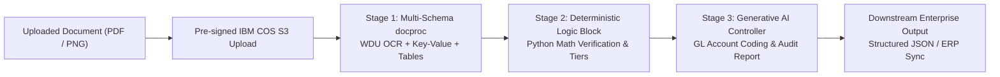

# IBM watsonx Orchestrate — Intelligent Document Processing (IDP)
## Enterprise Setup, Architecture, and Client Demonstration Guide

This guide provides an end-to-end technical and operational reference for deploying and demonstrating the **Multi-Document Intelligent Document Processing (IDP) Pipeline** powered by **IBM watsonx Orchestrate**.

---

## 1. Executive Summary & Architecture Overview

Modern enterprise financial operations (Accounts Payable, Procurement, and Expense Management) require ingesting diverse document types—including commercial **Invoices**, **Purchase Orders (POs)**, and **Receipts**—from multiple suppliers.

Traditional Optical Character Recognition (OCR) systems fail when document layouts shift. Conversely, standalone Large Language Models (LLMs) hallucinate mathematical calculations when processing financial tables.

This pipeline solves both challenges by combining **Watson Document Understanding (WDU)**, **Deterministic Python Logic**, and **Generative AI** into a 3-stage agentic workflow:



### Stage Breakdown

| Stage | Node Type | Technology | Responsibility |
| :--- | :--- | :--- | :--- |
| **Stage 1** | Text Extractor (`docproc`) | Watson Document Understanding (WDU) | Performs multi-page OCR, extracts 25+ Key-Value Pairs (KVPs), extracts multi-row line item tables, and calculates confidence scores (0.0 to 1.0) with bounding box geometry. |
| **Stage 2** | Logic Block (`aflow.script`) | Pure Python Sandbox Execution | Audits document arithmetic ($\sum \text{lines} = \text{subtotal}$, $\text{subtotal} + \text{tax} = \text{total}$), detects discrepancies ($\ge \$0.05$), and assigns approval tiers (`AUTO_APPROVED`, `VP_APPROVAL_REQUIRED`, `FLAGGED_MATH_MISMATCH`). |
| **Stage 3** | Generative Prompt (`aflow.prompt`) | watsonx LLM Controller (`gpt-oss-120b`) | Cleanses noisy OCR text, standardizes date/currency formats, categorizes each line item into corporate General Ledger (GL) accounting codes, and generates an audit memo. |

---

## 2. How watsonx Orchestrate Handles OCR & Document Processing

### The `docproc` Engine (Watson Document Understanding)
In watsonx Orchestrate, document understanding is powered by the native `docproc` node. When a document reference (pre-signed S3 URL) is passed into the flow, the engine executes the following:

1. **Text Extraction & Layout Analysis**:
   - Converts multi-page PDFs or high-resolution raster images (PNG, TIFF, JPEG) into word-level tokens.
   - Detects reading order, columns, and tabular blocks using spatial heuristics.
2. **Multi-Schema Automatic Document Classification**:
   - The flow defines three distinct schemas (`INVOICE_KVP_SCHEMA`, `PURCHASE_ORDER_KVP_SCHEMA`, `RECEIPT_KVP_SCHEMA`).
   - The engine examines the visual and textual cues in the document and automatically classifies it into the highest-scoring schema without requiring manual pre-sorting.
3. **Key-Value Pair (KVP) Extraction**:
   - Uses zero-shot layout language models to extract specified fields (e.g. `invoice_number`, `vendor_name`, `due_date`, `currency`).
   - Each extracted field is returned with:
     - `value`: Normalized text.
     - `confidence`: Floating point value between `0.0` and `1.0`.
     - `bbox`: Spatial coordinates (`x`, `y`, `width`, `height`, `page_number`) enabling visual overlay and audit trail verification.
4. **Line Item Table Extraction (`DocProcTable`)**:
   - Identifies grid boundaries and header rows (`Description`, `Quantity`, `Unit Price`, `Amount`).
   - Iterates across rows and returns typed arrays of line items for downstream processing.

---

## 3. The Deterministic Python Logic Block (`aflow.script`)

### Why LLMs Must NOT Perform Math
Generative AI models are probabilistic token predictors. When asked to sum 20 line items or calculate percentage sales taxes, LLMs frequently make subtle arithmetic errors or hallucinate rounding cents.

In this pipeline, financial reconciliation is delegated entirely to a deterministic Python logic node:

```python
# Deterministic reconciliation logic
subtotal_expected = sum(item["quantity"] * item["unit_price"] for item in items)
math_valid = abs(subtotal + tax - total) < 0.05

# Corporate governance routing policy
if not math_valid:
    approval_tier = "FLAGGED_MATH_MISMATCH"
elif total > 25000.00:
    approval_tier = "VP_APPROVAL_REQUIRED"
else:
    approval_tier = "AUTO_APPROVED"
```

### Sandbox Execution Constraints
watsonx Orchestrate script nodes run in a secure, isolated sandbox:
- **No external imports**: `import re` or `import numpy` will raise `ValueError: __import__ not found`.
- **Pure Python built-ins only**: Use string methods, list comprehensions, `float()`, `int()`, `sum()`, and `abs()`.
- **Node input access**: Inputs are mapped from upstream nodes via `flow["node_name"].output`.

---

## 4. The Generative AI Controller Node (`aflow.prompt`)

Once math validation and classification are complete, the `executive_structurer_node` executes:
1. **General Ledger (GL) Categorization**: Maps each line item into corporate financial categories:
   - Compute / Storage $\rightarrow$ `Cloud Infrastructure`
   - Security / Antivirus $\rightarrow$ `Cybersecurity Software`
   - Consulting / Hours $\rightarrow$ `Professional Services`
   - Servers / Switches $\rightarrow$ `Hardware Equipment`
2. **Executive Audit Notes**: Formulates a clear natural language narrative summarizing the document, noting any discrepancies or the specific approval tier assigned.

---

## 5. How to Build & Deploy the Flow in watsonx Orchestrate

You can create this flow either using the **Python Agent Development Kit (ADK)** or the **Web Flow Builder UI**.

### Method A: Deploying via Python ADK (Recommended)

1. **Install the ADK**:
   ```bash
   pip install ibm-watsonx-orchestrate
   ```

2. **Configure your Orchestrate Environment Profile**:
   ```bash
   orchestrate env add \
     --name client_demo \
     --url "https://api.ca-tor.watson-orchestrate.cloud.ibm.com/instances/<YOUR_INSTANCE_ID>" \
     --api-key "<YOUR_IBM_CLOUD_API_KEY>"
   orchestrate env activate client_demo
   ```

3. **Compile the Flow**:
   ```bash
   orchestrate flow compile flow/invoice_idp_flow.py
   ```

4. **Deploy the Flow to the Tenant**:
   ```bash
   orchestrate flow deploy --flow-file flow/invoice_idp_flow.py
   ```
   *Note the generated Flow ID returned upon deployment (e.g. `513e67d6-2974-4776-a0ac-5869876bee9a`).*

---

### Method B: Building via the Orchestrate Web Flow Builder UI

If you prefer building the flow visually in the watsonx Orchestrate web console:

1. Log into your watsonx Orchestrate tenant.
2. In the left navigation bar, open **Manage** $\rightarrow$ **Flows** and click **Create Flow**.
3. Set the flow name to `invoice_idp_flow`.
4. **Add Node 1 (Text Extractor / Document Processing)**:
   - Drag **Text Extractor** onto the canvas.
   - Name: `multi_docproc_node`.
   - Configure input variable: `document_ref` (Type: `String / File Reference`).
   - Define Schemas: Add schemas for `Invoice`, `PurchaseOrder`, and `Receipt` with their respective fields and line items table.
5. **Add Node 2 (Logic Block)**:
   - Drag **Logic Block** (Python Script) onto the canvas.
   - Name: `math_and_routing_node`.
   - Wire input: Map `ocr_kvps` to `flow["multi_docproc_node"].output.kvps` and `tables` to `flow["multi_docproc_node"].output.tables`.
   - Paste the reconciliation script from [`flow/invoice_idp_flow.py`](flow/invoice_idp_flow.py).
6. **Add Node 3 (Generative Prompt)**:
   - Drag **Generative Prompt** onto the canvas.
   - Name: `executive_structurer_node`.
   - Model: Select `groq/openai/gpt-oss-120b` or `ibm/granite-3-8b-instruct`.
   - Wire upstream variables (`ocr_text`, `computed_subtotal`, `approval_tier`, `math_summary`).
   - Set Output Schema to `StructuredInvoiceRecord`.
7. **Connect Sequence**:
   - Connect `START` $\rightarrow$ `multi_docproc_node` $\rightarrow$ `math_and_routing_node` $\rightarrow$ `executive_structurer_node` $\rightarrow$ `END`.
8. Click **Save** and **Deploy**.

---

## 6. How to Create the Agent & Bind the Flow

An Agent wraps the Flow with conversational autonomy and slot-filling capabilities.

1. Review the agent specification in [`agent/invoice_agent.yaml`](agent/invoice_agent.yaml):
   ```yaml
   spec_version: v1
   kind: native
   name: invoice_idp_agent
   display_name: Invoice IDP Pipeline Agent
   style: react_core
   llm: groq/openai/gpt-oss-120b
   instructions: |
     You are an automated Invoice Intelligent Document Processing (IDP) Agent.
     When the user asks to process or analyze an invoice document:
     1. Immediately invoke the `invoice_idp_flow` tool.
     2. Return the structured JSON result enclosed in ```json ... ``` fences.
   tools:
     - invoice_idp_flow
     - i__get_flow_status_intrinsic_tool__
   ```

2. **Import and Deploy the Agent**:
   ```bash
   orchestrate agent import -f agent/invoice_agent.yaml
   ```
   *Note the generated Agent ID returned (e.g. `23215e30-2f2f-4373-974b-0d7bb89e657a`).*

---

## 7. How to Locate Tenant URL, API Key, Flow ID, and Agent ID

| Parameter | Description | Where to Find It |
| :--- | :--- | :--- |
| **`WXO_TENANT_URL`** | The API root endpoint for your Orchestrate instance. | In your browser address bar when logged into Orchestrate: e.g. `https://api.ca-tor.watson-orchestrate.cloud.ibm.com/instances/e2def58b-0869-4446-a0e3-55ecca8f07e9` |
| **`WXO_API_KEY`** | IBM Cloud IAM User / Service API Key. | In [cloud.ibm.com](https://cloud.ibm.com) $\rightarrow$ **Manage** $\rightarrow$ **Access (IAM)** $\rightarrow$ **API keys** $\rightarrow$ Click **Create**. |
| **`WXO_FLOW_ID`** | The UUID of the deployed flow. | In the web console URL when opening the flow: `/flows/513e67d6-2974-4776-a0ac-5869876bee9a` or run `orchestrate flow list`. |
| **`WXO_AGENT_ID`** | The UUID of the deployed agent. | In the web console URL when opening the agent: `/agents/23215e30-2f2f-4373-974b-0d7bb89e657a` or run `orchestrate agent list`. |

---

## 8. Headless Direct Flow vs Conversational Agent Execution

This demo supports both execution architectures side-by-side:

### Architecture A: Headless Direct Flow (Recommended for Automated Systems)
- **Protocol**: `POST /v1/orchestrate/flows/{flow_id}/run/async` with `{"document_ref": s3_url}`.
- **Workflow**:
  1. Backend receives document from UI upload, email, or webhook.
  2. Uploads file to pre-signed IBM COS bucket via `POST /v1/orchestrate/upload-to-s3`.
  3. Triggers flow asynchronously and polls `GET /v1/orchestrate/flows?instance_id={id}` until `state == "completed"`.
  4. Returns raw typed JSON directly to downstream systems.
- **Best For**: High-throughput automated batch processing, microservice backends, ERP data pipelines.

### Architecture B: Conversational Agent 2-Turn (Recommended for User Assistants)
- **Protocol**: `POST /v1/orchestrate/runs`.
- **Workflow**:
  1. **Turn 1**: Client sends message: *"Process this invoice"*. The agent detects that the `invoice_idp_flow` tool requires a `document_ref` parameter and issues a slot request.
  2. **Turn 2**: Client provides the S3 file context payload (`type: "file_download"`). The agent autonomously invokes the flow, evaluates the response, and formats a conversational answer.
- **Best For**: Customer-facing or internal employee chat portals where users interactively ask questions about invoice status.

---

## 9. Running the Client Demo Application

The client demo package is completely self-contained. It requires no external database or email accounts.

### Step 1: Configure Credentials
In this directory, copy the template and insert your IBM Cloud credentials:
```bash
cp .env.example .env
```
Edit `.env`:
```ini
WXO_TENANT_URL=https://api.ca-tor.watson-orchestrate.cloud.ibm.com/instances/<YOUR_INSTANCE_ID>
WXO_API_KEY=<YOUR_IBM_CLOUD_API_KEY>
WXO_FLOW_ID=513e67d6-2974-4776-a0ac-5869876bee9a
WXO_AGENT_ID=23215e30-2f2f-4373-974b-0d7bb89e657a
```

### Step 2: Start the Demo Server
Run the automated launcher:
```bash
./run_demo.sh
```
*(Alternatively, activate your Python virtual environment and run `uvicorn app:app --port 8000`).*

### Step 3: Open the Dashboard
Open your browser to:
```
http://127.0.0.1:8000
```

---

## 10. Client Demonstration Script (What to Show Tomorrow)

When presenting to your client, follow this recommended walkthrough:

1. **Architecture Introduction (2 mins)**:
   - Highlight the **3-Tier Design**: Watson Document Understanding OCR $\rightarrow$ Python deterministic math reconciliation $\rightarrow$ GenAI GL categorization.
   - Emphasize that **financial accuracy is guaranteed** because math is not left to an LLM.

2. **Live Test 1: Standard Commercial Invoice (3 mins)**:
   - Click the sample pill **"Invoice Acme Cloud 0042"** (or upload a PDF).
   - Select **Headless Direct Flow**.
   - Click **"Upload to wxO S3 & Run IDP Pipeline"**.
   - Walk through the **Live Stepper** as each stage completes.
   - Point out:
     - 25+ extracted Key-Value Pairs with confidence scores $\ge 98\%$.
     - Line items table with automated General Ledger tags (`Cloud Infrastructure`, `Professional Services`).
     - Green **`AUTO_APPROVED`** audit badge.

3. **Live Test 2: High-Value Purchase Order (Multi-Tier Policy) (2 mins)**:
   - Click the sample pill **"Po Global Logistics 8812"**.
   - Run the pipeline.
   - Point out that because the authorized total exceeds \$10,000 / \$25,000, the system automatically tags it **`VP_APPROVAL_REQUIRED`**.

4. **Live Test 3: Conversational Agent Mode (2 mins)**:
   - Toggle the mode selector to **Conversational Agent (2-Turn)**.
   - Run the document.
   - Show how the ReAct agent autonomously fills the file slot and delivers structured JSON alongside conversational audit commentary.

5. **Closing / Enterprise Extensibility (1 min)**:
   - Show how persisted records in the table can instantly map into SAP, Oracle NetSuite, Salesforce, or Odoo via standard REST / XML-RPC APIs.
